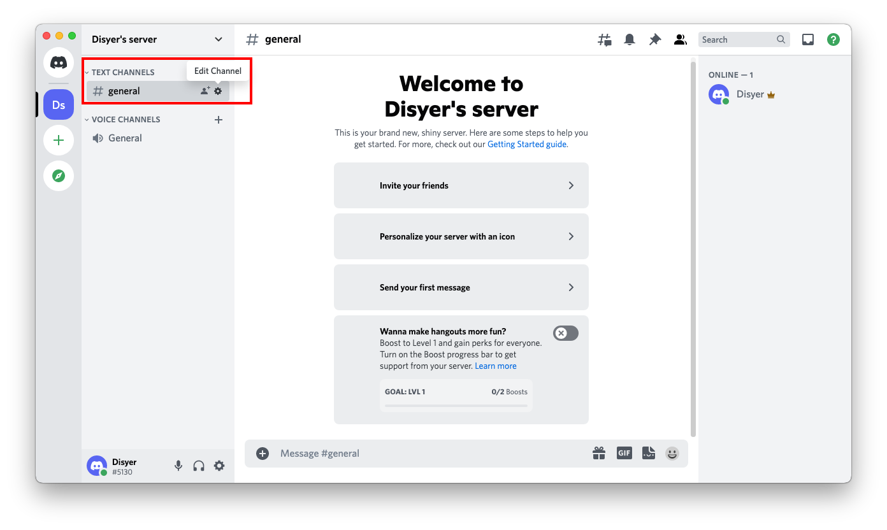
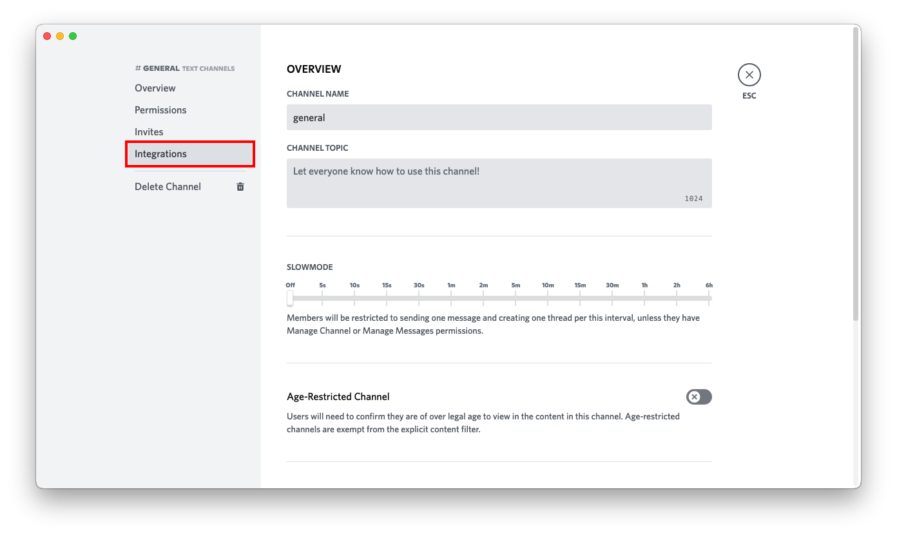
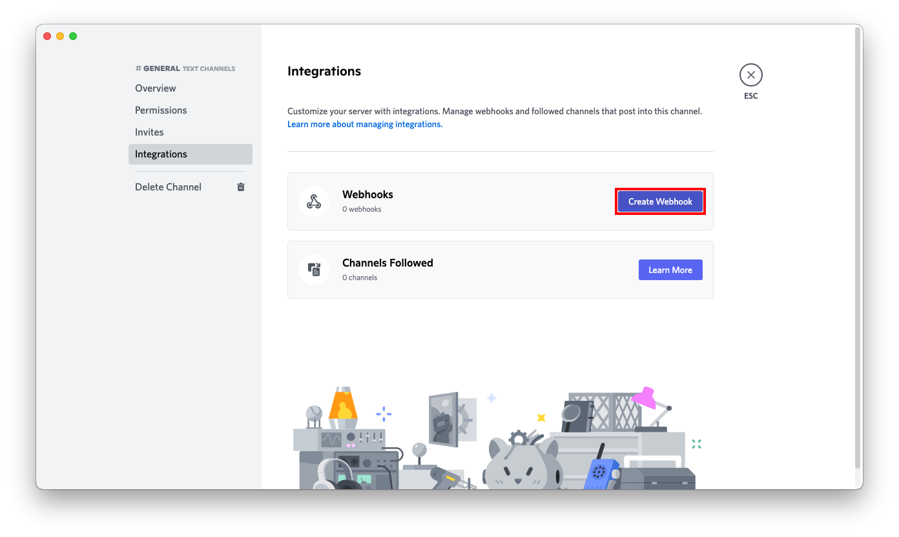
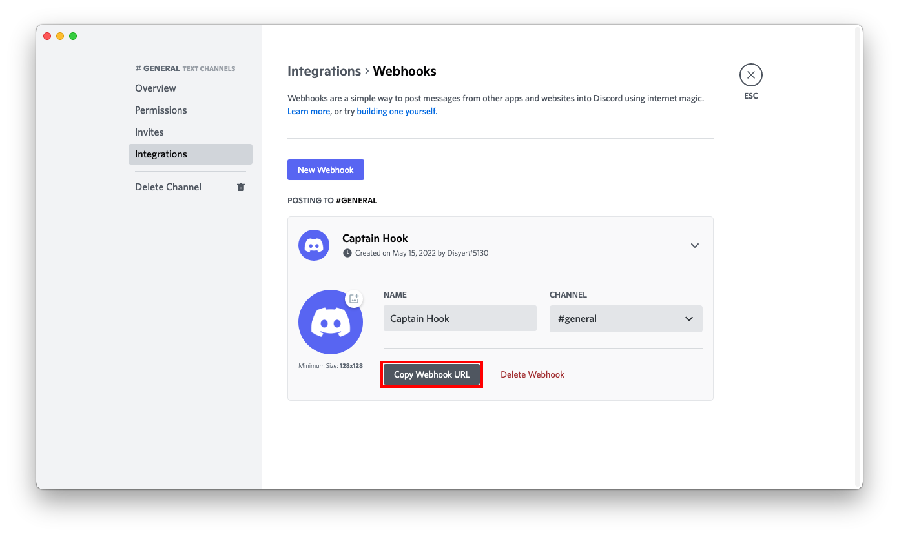
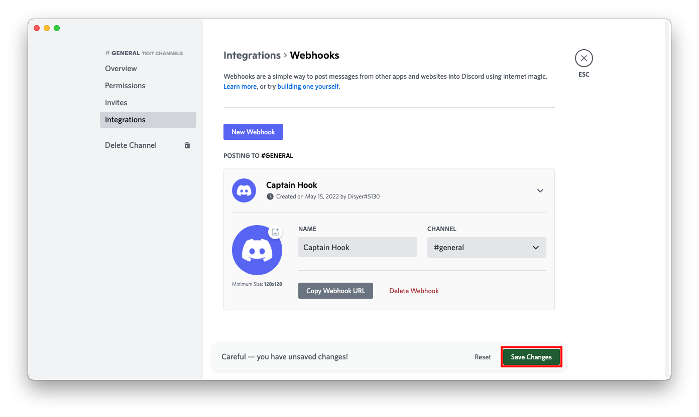

# Discord

## URL Format

Your Discord Webhook-URL will look like this:

!!! info ""
    https://discord.com/api/webhooks/__`WEBHOOK_ID`__/__`TOKEN`__

For more information about Discord webhooks, see the [official documentation](https://discord.com/developers/docs/resources/webhook).

The shoutrrr service URL should look like this:

!!! info ""
    discord://__`TOKEN`__@__`WEBHOOK_ID`__[?thread_id=__`THREAD_ID`__]

The webhook URL that Discord shows has no API version in its path.
Shoutrrr takes only the webhook ID and token from it, and sends to Discord API v10 at `https://discord.com/api/v10/webhooks/`.
A request to the URL as Discord shows it would use Discord's default version.
That default is v6, which Discord has deprecated.

The webhook ID is a number, and Shoutrrr rejects a service URL whose webhook ID is not one.

### Thread Support

To send messages to a specific thread in a Discord channel, include the `thread_id` query parameter in the service URL with the ID of the target thread. For example:

!!! info ""
    discord://__`TOKEN`__@__`WEBHOOK_ID`__?thread_id=__`THREAD_ID`__

You can obtain the `thread_id` by right-clicking a thread in Discord and selecting "Copy ID" (requires Developer Mode to be enabled in Discord settings). For more details on threads, see Discord's [thread documentation](https://discord.com/developers/docs/resources/channel#thread-object). Learn how to enable Developer Mode in Discord's [support article](https://support.discord.com/hc/en-us/articles/206346498-Where-can-I-find-my-User-Server-Message-ID-).

The thread ID is a number, and Shoutrrr rejects a thread ID that is not one.
A `thread_id` send param sends that message to another thread, in JSON mode too.

### New Threads in Forum and Media Channels

A webhook on a forum or media channel can only send into a thread, which Discord's app shows as a post.
Each message therefore needs either `thread_id` for an existing thread or `thread_name` to create a new one.
With `thread_name`, each message creates a thread with that name, of up to 100 characters:

!!! example "New Thread"
    ```bash
    shoutrrr send --url "discord://TOKEN@WEBHOOK_ID?thread_name=Deploy%20finished" --message "Version 1.4 is live"
    ```

A message long enough for several requests creates the thread with the first one, and Shoutrrr sends the rest into that thread.
If the first request creates nothing, such as when Discord rejects it or the connection cannot be made, the next one creates the thread instead.
If the first request ends without a usable answer, such as a dropped connection, Shoutrrr sends no more of the message, since it cannot tell which thread to send into.
A `thread_name` send param sets the name for one message.
Shoutrrr rejects `thread_name` together with `thread_id`, since Discord takes one or the other.
JSON mode sends its payload as it is, so set `thread_name` in the payload there.

## Webhook Customization

You can customize the webhook's appearance by overriding the default username and avatar that were set when creating the webhook.

!!! example "Custom Username and Avatar"
    ```bash
    shoutrrr send --url "discord://TOKEN@WEBHOOK_ID?username=MyBot&avatar=https://example.com/avatar.png" --message "Hello from custom bot!"
    ```

## Message Content

For simple text messages without embeds, Shoutrrr now uses Discord's `content` field directly, providing cleaner message formatting and better compatibility with Discord's features.

!!! example "Simple Text Message"
    ```bash
    shoutrrr send --url "discord://TOKEN@WEBHOOK_ID" --message "Hello, World!"
    ```

    This sends a plain text message using the `content` field instead of an embed.

## Message Level

A sender can set a message level with the `level` param, as `Params.SetLevel` does.
Embeds then use the color configured for that level with `colorDebug`, `colorInfo`, `colorWarn`, or `colorError`.
A `color` in the URL or the send params takes precedence over the level, even when it is set to the default.
A short message without a title is sent as plain content, which has no embed to color, so the level leaves it as it is.

## Mentions

The `mentions` key does two things:

- __Adds mentions__: Shoutrrr writes each listed mention into the message, so the message pings them.
- __Allows only them__: no other mention in the message pings, so `@everyone` in a log line shows as text unless the list includes it.

Discord never pings a mention inside an embed, so Shoutrrr puts the listed mentions in the message content.

### Setting Mentions

| Mention        | Pings                                   |
|----------------|-----------------------------------------|
| `everyone`     | everyone in the channel, as `@everyone` |
| `here`         | the members who are online, as `@here`  |
| `user:USER_ID` | the user with that ID                   |
| `role:ROLE_ID` | the members of the role with that ID    |

!!! example "Ping a Role"
    ```bash
    shoutrrr send --url "discord://TOKEN@WEBHOOK_ID?mentions=here,role:ROLE_ID" --message "Backup failed"
    ```

Replace `USER_ID` or `ROLE_ID` with the ID that Discord shows with *Copy User ID* or *Copy Role ID* in Developer Mode.

### How Mentions Are Sent

Shoutrrr puts the mentions in the message content of a send's first request, and every request lets only them ping.
Where they appear depends on how the message is sent:

| Message                                              | Content of the first request                             |
|------------------------------------------------------|----------------------------------------------------------|
| Short message sent as plain content                  | The mentions, then the message: `@here Backup failed`    |
| Message sent as embeds                               | The mentions alone, shown above the embeds               |
| Short message over 2000 characters with the mentions | The mentions alone, with the message moved into an embed |

A long message that needs several requests pings once, from its first request.

A mention already in the message text pings when the list allows it, such as `<@USER_ID>` for a listed `user:USER_ID`.
Discord treats `@everyone` and `@here` as one kind of mention, so listing either one lets both ping from the text.

!!! note ""
    Discord still applies its own rules, such as a role having to be mentionable, as its [allowed mentions](https://discord.com/developers/docs/resources/message#allowed-mentions-object) documentation describes.
    JSON mode sends its payload as it is, so `mentions` does not apply there.

## Message Chunking

Shoutrrr splits a long plain message so that each webhook request fits Discord's limits.
These come from Discord's [Execute Webhook](https://discord.com/developers/docs/resources/webhook#execute-webhook) parameters and [Embed Limits](https://discord.com/developers/docs/resources/message#embed-object-embed-limits):

| Limit                          | Value                                                                        |
|--------------------------------|------------------------------------------------------------------------------|
| Message content                | 2000 characters                                                              |
| Embed description              | 4096 characters                                                              |
| Embeds in one message          | 10                                                                           |
| Text across a message's embeds | 6000 characters, counting titles, descriptions, fields, footers, and authors |

How the message is split depends on `splitLines`:

- __`splitLines=yes`__ (default): each line becomes an embed. A line holds up to 4096 characters, and a longer line is shortened. Blank lines are left out.
- __`splitLines=no`__: the text is split into chunks of up to 2000 characters, at a space or line break near the limit when there is one. Each chunk becomes an embed. The space or line break at each split is left out, and so are chunks of only whitespace.

Shoutrrr sends the embeds in as many requests as they need.
Each request holds up to 10 embeds and 6000 characters of embed text, counting the title on its first embed and each embed's level footer.
A message that becomes a single line or chunk of up to 2000 characters, without a title, is sent as plain message content instead of an embed.

!!! example "Long Message Chunking"
    ```bash
    shoutrrr send --url "discord://TOKEN@WEBHOOK_ID?splitLines=no" --message "$(cat build.log)"
    ```

## Enhanced Embeds

Shoutrrr supports rich embed formatting with authors, images, thumbnails, and custom fields when using the Go library API. Embeds are automatically created when using structured message items with metadata. For detailed information about embed objects, refer to Discord's [embed documentation](https://discord.com/developers/docs/resources/channel#embed-object).

Discord accepts at most 10 embeds in one message, with at most 6000 characters across their titles, descriptions, fields, footers, and author names, so items that do not fit are sent in further messages, with each item's file attached to the message that carries its embed.
Text longer than Discord allows in an embed is shortened and ends with ` [...]`: 256 characters for a title, field name, or author name, 4096 for a description, and 1024 for a field value, and fields past the 25th are left out.
An item still over 6000 characters on its own loses fields from the end, then has its description shortened.

!!! note ""
    Enhanced embed features are only available through the Go library API using `SendItems` with `MessageItem` structs containing metadata. The CLI does not support embed parameters.

## File Attachments

Shoutrrr supports attaching files to your Discord messages when using the Go library. Files are sent as multipart/form-data along with the message payload. See Discord's [webhook execution documentation](https://discord.com/developers/docs/resources/webhook#execute-webhook) for details on file attachments.

Discord limits the size of each file to 20 MiB by default, and allows larger files on servers with a higher Boost Tier, as its [Uploading Files](https://discord.com/developers/docs/reference#uploading-files) reference describes.
Shoutrrr cannot tell which limit a webhook's server has, so it sends each file and reports Discord's error for one that is too large.

!!! note ""
    File attachments require the webhook to have appropriate permissions, and files must be accessible from the system running Shoutrrr. File attachments are not supported in the CLI.

## Delivery and Errors

### Delivery

Shoutrrr sets the webhook's `wait` parameter, so Discord answers only after it has saved the message.
A send that succeeds means Discord saved the message.

### Errors

When Discord rejects a message, the error names these parts in order:

- __Status__: the HTTP status, such as `404 Not Found`.
- __Reason__: Discord's message, such as `Unknown Webhook`.
- __Code__: the code from Discord's [JSON Error Codes](https://discord.com/developers/docs/topics/opcodes-and-status-codes#json-json-error-codes) table, such as `(code 10015)`.
- __Invalid fields__: up to five fields Discord found invalid, each with Discord's code for its error. They appear only for an Invalid Form Body (code 50035).

| Cause                      | Error                                                                                         |
|----------------------------|-----------------------------------------------------------------------------------------------|
| Deleted webhook            | `404 Not Found: Unknown Webhook (code 10015)`                                                 |
| Embed description too long | `400 Bad Request: Invalid Form Body (code 50035): embeds.0.description: BASE_TYPE_MAX_LENGTH` |

A response that is not Discord's error JSON, such as an error page from a proxy, gives the status alone.

--8<-- "docs/services/chat/discord/config.md"

## Creating a webhook in Discord

1. Open your channel settings by first clicking on the gear icon next to the name of the channel.


2. In the menu on the left, click on *Integrations*.


3. In the menu on the right, click on *Create Webhook*.


4. Set the name, channel, and icon to your liking and click the *Copy Webhook URL* button.


5. Press the *Save Changes* button.


6. Format the service URL:

```url
https://discord.com/api/webhooks/693853386302554172/W3dE2OZz4C13_4z_uHfDOoC7BqTW288s-z1ykqI0iJnY_HjRqMGO8Sc7YDqvf_KVKjhJ
                                 └────────────────┘ └──────────────────────────────────────────────────────────────────┘
                                     webhook id                                    token

discord://W3dE2OZz4C13_4z_uHfDOoC7BqTW288s-z1ykqI0iJnY_HjRqMGO8Sc7YDqvf_KVKjhJ@693853386302554172?thread_id=123456789
          └──────────────────────────────────────────────────────────────────┘ └────────────────┘ └─────────────────┘
                                          token                                    webhook id           thread id
```
