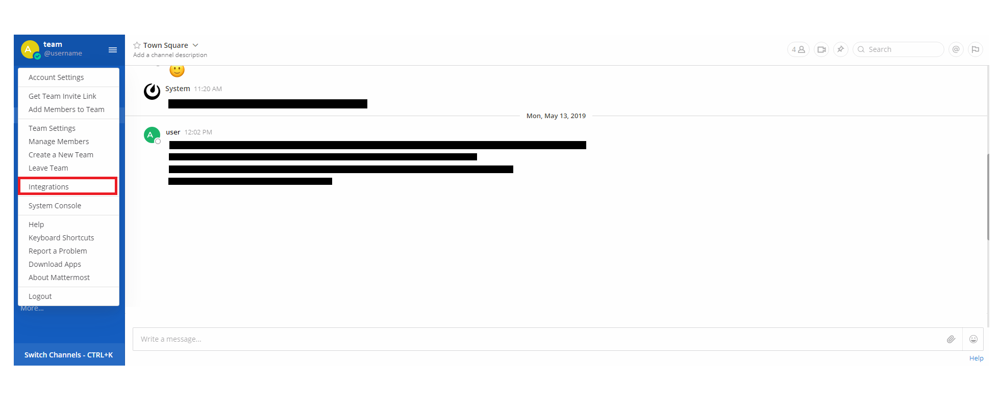
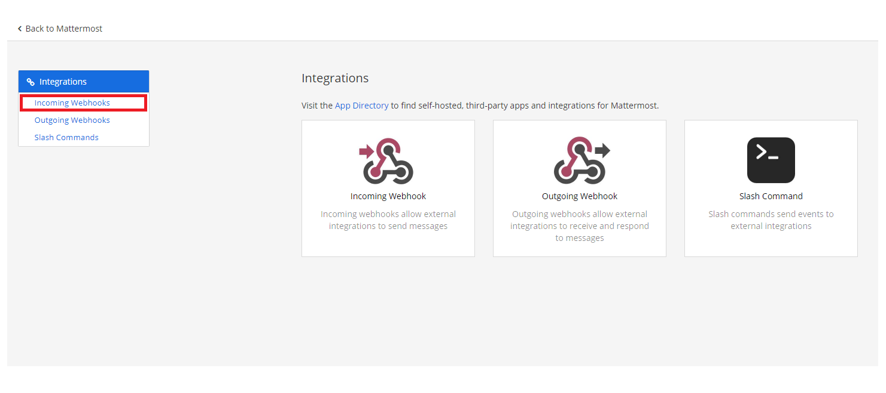
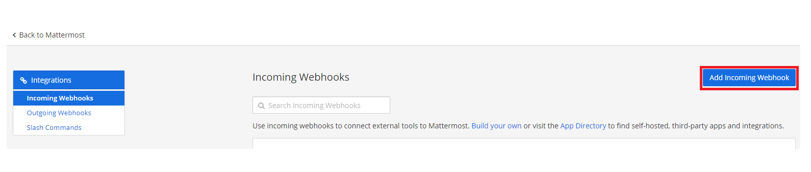
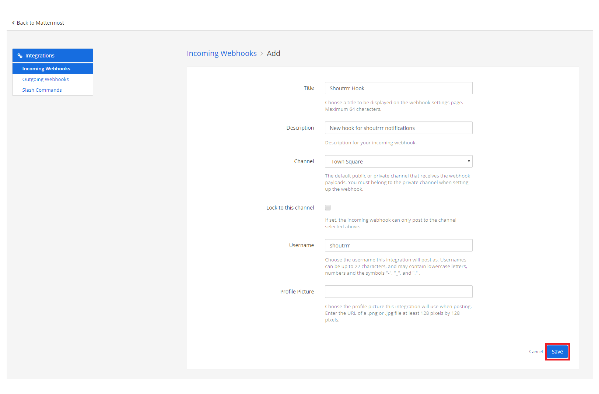
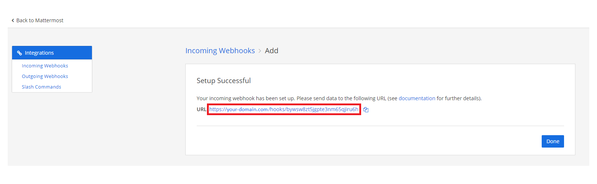

# MatterMost

## URL Format

!!! info ""
    mattermost://[__`username`__@]__`mattermost-host`__/__`token`__[/__`channel`__][?icon=__`smiley`__&disabletls=__`yes`__]

--8<-- "docs/services/chat/mattermost/config.md"

## Creating a Webhook in MatterMost

1. Open up the Integrations page by clicking on *Integrations* within the menu


2. Click *Incoming Webhooks*


3. Click *Add Incoming Webhook*


4. Fill in the information for the webhook and click *Save*


5. If you did everything correctly, MatterMost will give you the *URL* to your newly created webhook


6. Format the service URL

```url
https://your-domain.com/hooks/bywsw8zt5jgpte3nm65qjiru6h
                              └────────────────────────┘
                                        token
mattermost://your-domain.com/bywsw8zt5jgpte3nm65qjiru6h
                             └────────────────────────┘
                                       token
```

## Additional URL configuration

Mattermost provides functionality to post as another user or to another channel, compared to the webhook configuration.
<br/>
To do this, you can add a *user* and/or *channel* to the service URL.

```url
mattermost://shoutrrrUser@your-domain.com/bywsw8zt5jgpte3nm65qjiru6h/shoutrrrChannel
             └──────────┘                 └────────────────────────┘ └─────────────┘
                 user                               token                channel
```

The channel can also be `@username` to send a direct message to that user.

!!! note
    Mattermost ignores the user override unless a system admin enables [Enable integrations to override usernames](https://docs.mattermost.com/configure/configuration-settings.html#enable-integrations-to-override-usernames), and ignores the icon unless [Enable integrations to override profile picture icons](https://docs.mattermost.com/configure/configuration-settings.html#enable-integrations-to-override-profile-picture-icons) is enabled. See the [Mattermost incoming webhook documentation](https://docs.mattermost.com/developers/integrate/webhooks/incoming).

## Using an Icon

You can customize the notification icon using the `icon` query parameter. The icon can be either a Mattermost emoji name or an image URL.

### Emoji Icon

```url
mattermost://your-domain.com/bywsw8zt5jgpte3nm65qjiru6h?icon=rocket
```

### URL Icon

```url
mattermost://your-domain.com/bywsw8zt5jgpte3nm65qjiru6h?icon=https://example.com/logo.png
```

## Passing parameters via code

You can also pass parameters to the `Send` function. The following example contains all parameters that are currently supported.

```go
params := &types.Params{
    "username":   "overwriteUserName",
    "channel":    "overwriteChannel",
    "icon":       "overwriteIcon",
    "title":      "overwriteTitle",
    "disabletls": "yes",
}

err := service.Send("this is a message", params)
```

These override the options passed via the URL for that send only.
