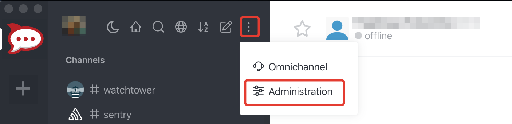
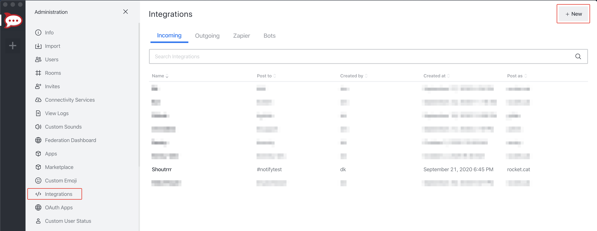
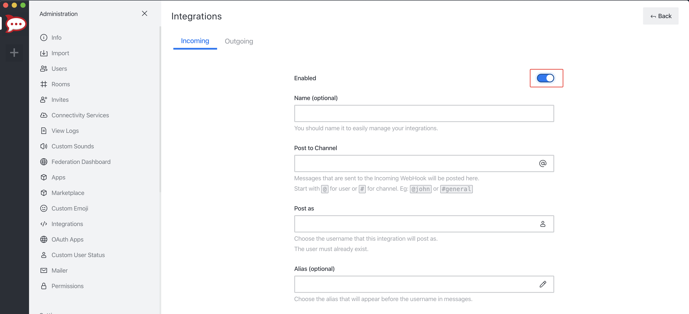
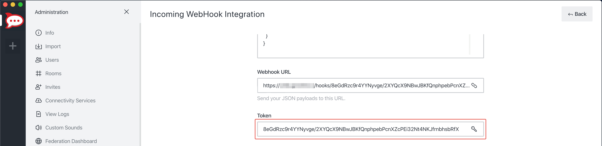

# Rocket.chat

## URL Format

!!! info ""
    rocketchat://[__`username`__@]__`rocketchat-host`__/__`token`__[/__`channel`&#124;`@recipient`__]*

--8<-- "docs/services/chat/rocketchat/config.md"

## TLS

Rocket.Chat sends over HTTPS by default.
Set `disabletls=yes` to send over HTTP instead, for a self-hosted server without TLS.
That leaves the connection unencrypted.

Set `skiptlsverify=yes` when the server's certificate cannot be verified, such as a self-signed one.
The connection stays encrypted, but Shoutrrr does not check which server it talks to.

Both options can also be passed as send params, which apply to that send only.
A custom HTTP client set through `SetHTTPClient` or the `Client` field keeps its own TLS settings, so `skiptlsverify` does not change it.
Shoutrrr logs a warning the first time a send goes out without TLS, and the first time a send skips certificate verification through its own client.

## Creating a Webhook in Rocket.chat

1. Open up the chat Administration by clicking on *Administration* menu


2. Open *Integrations* and then click *New*


3. Fill in the information for the webhook and click *Save*. Please don't forget to Enable your integration.


5. If you did everything correctly, Rocket.chat will give you the *URL* and *Token* to your newly created webhook.


6. Format the service URL

```url
rocketchat://your-domain.com/8eGdRzc9r4YYNyvge/2XYQcX9NBwJBKfQnphpebPcnXZcPEi32Nt4NKJfrnbhsbRfX
                             └────────────────────────────────────────────────────────────────┘
                                                           token
```

## Additional URL configuration

Rocket.chat provides functionality to post as another user or to another channel / user, compared to the webhook configuration.
<br/>
To do this, you can add a *sender* and/or *channel* / *receiver* to the service URL.

```
rocketchat://shoutrrrUser@your-domain.com/8eGdRzc9r4YYNyvge/2XYQcX9NBwJBKfQnphpebPcnXZcPEi32Nt4NKJfrnbhsbRfX/shoutrrrChannel
             └──────────┘                 └────────────────────────────────────────────────────────────────┘ └─────────────┘
                sender                                                   token                                   channel

rocketchat://shoutrrrUser@your-domain.com/8eGdRzc9r4YYNyvge/2XYQcX9NBwJBKfQnphpebPcnXZcPEi32Nt4NKJfrnbhsbRfX/@shoutrrrReceiver
             └──────────┘                 └────────────────────────────────────────────────────────────────┘ └───────────────┘
                sender                                                   token                                    receiver
```

## Passing parameters via code

If you want to, you also have the possibility to pass parameters to the `send` function.
<br/>
The following example contains all parameters that are currently supported.

```gotemplate
params := (*types.Params)(
 &map[string]string{
  "username": "overwriteUserName",
  "channel": "overwriteChannel",
  "disabletls": "no",
  "skiptlsverify": "no",
 },
)

service.Send("this is a message", params)
```

This will overwrite any options, that you passed via URL.
Any other parameter fails the send, apart from `title`, `message`, and `level`, which every service accepts.

For more Rocket.chat Webhooks options see [official guide](https://docs.rocket.chat/guides/administrator-guides/integrations).
