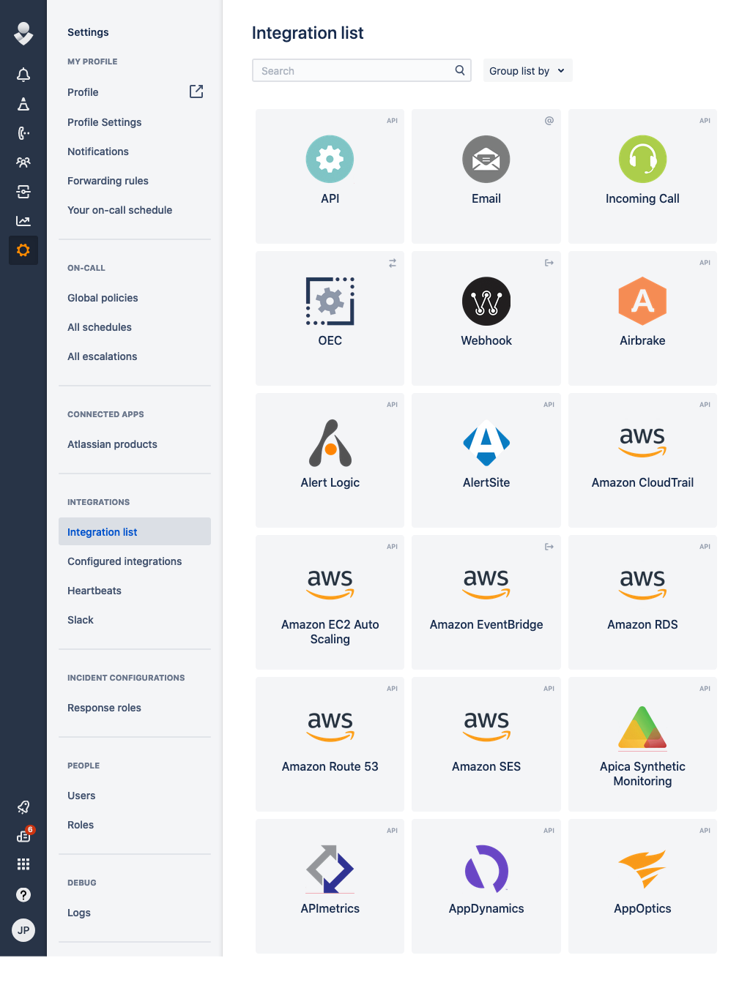
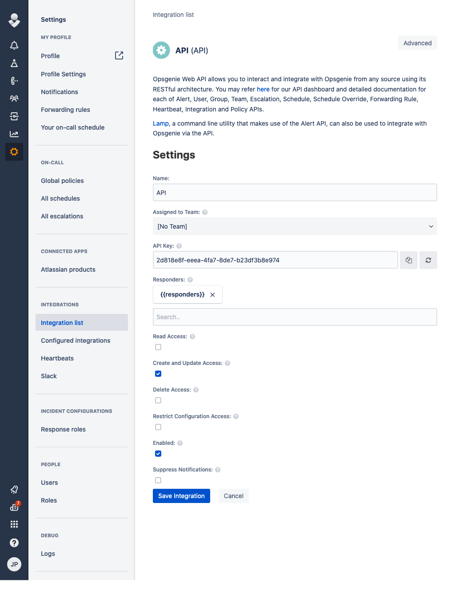

# OpsGenie

## URL Format

--8<-- "docs/services/incident/opsgenie/config.md"

## Creating a REST API endpoint in OpsGenie

1. Open up the Integration List page by clicking on *Settings => Integration List* within the menu


2. Click *API => Add*

3. Make sure *Create and Update Access* and *Enabled* are checked and click *Save Integration*


4. Copy the *API Key*

5. Format the service URL

The host can be either api.opsgenie.com or api.eu.opsgenie.com depending on the location of your instance. See
the [OpsGenie documentation](https://docs.opsgenie.com/docs/alert-api) for details.
The host can be left out, as in `opsgenie:///API_KEY`, in which case `api.opsgenie.com` is used.

```url
opsgenie://api.opsgenie.com/eb243592-faa2-4ba2-a551q-1afdf565c889
                            └───────────────────────────────────┘
                                           token
```

## Passing parameters via code

You can pass additional parameters to the `Send` function.
The following example contains all parameters that are currently supported.

```go
service.Send("An example alert message", &types.Params{
    "title":       "An example title",
    "alias":       "Life is too short for no alias",
    "description": "Every alert needs a description",
    "responders":  "team:4513b7ea-3b91-438f-b7e4-e3e54af9147c,team:NOC,user:trinity@opsgenie.com,escalation:Nightwatch Escalation,schedule:First Responders Schedule",
    "visibleTo":   "team:rocket_team,user:trinity@opsgenie.com",
    "actions":     "Restart,AnExampleAction",
    "tags":        "OverwriteQuietHours,Critical",
    "details":     "key1:value1,key2:value2",
    "entity":      "An example entity",
    "source":      "The source",
    "priority":    "P1",
    "user":        "Dracula",
    "note":        "Here is a note",
})
```

## Parameter formats

- `responders` and `visibleTo` are comma-separated `type:identifier` entries.
  An identifier in the OpsGenie ID format, such as `4513b7ea-3b91-438f-b7e4-e3e54af9147c`, is sent as the ID.
  Otherwise it is sent as the username for `user` and as the name for `team`, `escalation`, and `schedule`.
  `visibleTo` accepts only `team` and `user` entries, as OpsGenie requires, and any other type fails the send.
- `actions` and `tags` are comma-separated lists.
- `details` is a comma-separated list of `key:value` pairs.
  Each pair splits at its first colon, so values can contain colons, as in `runbook:https://wiki.example.com/disk`, while keys cannot.
  Neither keys nor values can contain commas.
- The alert message is the title when one is set, and the notification message otherwise, cut to 130 characters.
  The notification message is sent as the description when a title is set or when it is cut.

See the [OpsGenie Alert API documentation](https://docs.opsgenie.com/docs/alert-api#create-alert) for the limits of each field.

## Message level

A sender can set a message level with the `level` param, as `Params.SetLevel` does.
When neither the URL nor the send params set `priority`, the level picks it:

| Level   | Priority           |
|---------|--------------------|
| Debug   | P5 (informational) |
| Info    | P4 (low)           |
| Warning | P3 (moderate)      |
| Error   | P2 (high)          |

P1 (critical) is left for alerts that configure it.
A `priority` in the URL or the send params takes precedence over the level.

## Optional parameters

You can optionally specify the parameters in the URL:

!!! info ""
    opsgenie://api.opsgenie.com/eb243592-faa2-4ba2-a551q-1afdf565c889?alias=Life+is+too+short+for+no+alias&description=Every+alert+needs+a+description&actions=An+action&tags=tag1,tag2&entity=An+example+entity&source=The+source&priority=P1&user=Dracula&note=Here+is+a+note

Example using the command line:

```shell
shoutrrr send -u 'opsgenie://api.eu.opsgenie.com/token?tags=tag1,tag2&description=testing&responders=user:superuser,team:NOC&entity=Example+Entity&source=Example+Source&actions=asdf,bcde' -m "Hello World6"
```
