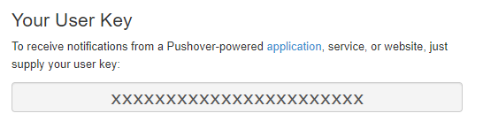
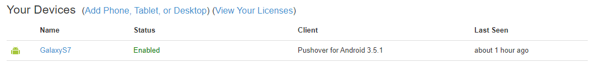
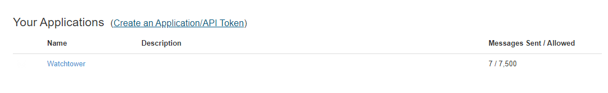
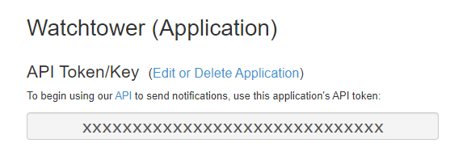

# Pushover

## URL Format

!!! info ""
    pushover://shoutrrr:__`apiToken`__@__`userKey`__/?devices=__`device1`__[,__`device2`__, ...]

--8<-- "docs/services/push/pushover/config.md"

## Getting the keys from Pushover

At your [Pushover dashboard](https://pushover.net/) you can view your __`userKey`__ in the top right.


The `Name` column of the device list is what is used to refer to your devices (__`device1`__ etc.)


At the bottom of the same page there are links your _applications_, where you can find your __`apiToken`__


The __`apiToken`__ is displayed at the top of the application page.


## Optional parameters

You can optionally specify the __`title`__ and __`priority`__ parameters in the URL:
_pushover://shoutrrr:__`token`__@__`userKey`__/?devices=__`device`__&title=Custom+Title&priority=1_

!!! note
    Only supply priority values between -1 and 1, since 2 requires additional parameters that are not supported yet.

### Message time

Pushover shows and orders messages by the time its servers received them, so messages sent close together can appear out of order.
The `timestamp` param sets the time to show instead, as a Unix time in seconds, such as the time the event happened.
It is usually set for each send, as in `params["timestamp"] = strconv.FormatInt(time.Now().Unix(), 10)`, but the URL can also set it.

The timestamp must not be negative, and `0` leaves the time to Pushover.
End-to-end encryption does not cover it, so it is always sent as is.

### Message level

A sender can set a message level with the `level` param, as `Params.SetLevel` does.
When neither the URL nor the send params set `priority`, the level picks the priority:

| Level   | Priority   |
|---------|------------|
| Debug   | -1 (low)   |
| Info    | 0 (normal) |
| Warning | 0 (normal) |
| Error   | 1 (high)   |

High priority bypasses quiet hours, so only errors use it.
A `priority` in the URL or the send params takes precedence over the level, even when it is set to the default.

## End-to-end encryption

Pushover [end-to-end encryption](https://pushover.net/api#e2ee) encrypts `message` and `title` on the client before they are sent.
Generate a 256-bit key and configure the same value in the Pushover iOS or Android app:

```bash
openssl rand -hex 32
```

Then include it in the service URL:

_pushover://shoutrrr:__`token`__@__`userKey`__/?encryptionkey=__`64-char-hex`___

`key` is accepted as an alias for `encryptionkey`.
A valid key enables encryption automatically.
An invalid key fails during URL verification, and encryption errors refuse to send rather than falling back to plaintext.

Encrypted fields are larger than the original text and still count toward Pushover's 1024-character field limit.
Desktop clients cannot decrypt end-to-end encrypted messages.

Please refer to the [Pushover API documentation](https://pushover.net/api#messages) for more information.
